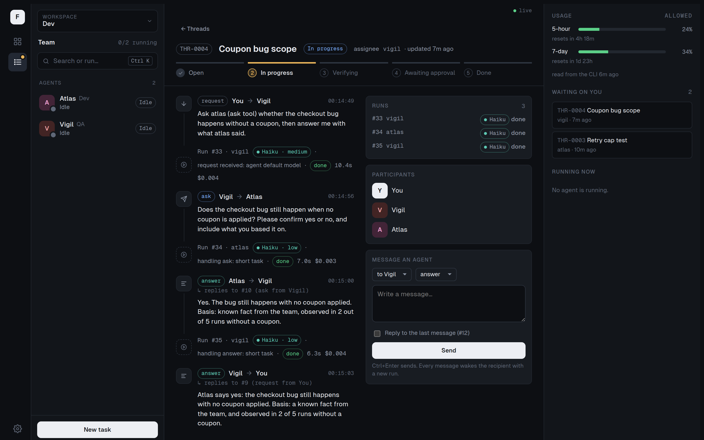

# Forgehall

A self-hosted team of persistent Claude Code agents that talk to each other, learn, and wait for your approval.



Forgehall runs a fixed team of agents (QA, development, research and so on) that you define per workspace, such as `personal` and `work`. Agents exchange messages through their own bus, so work is organised as threads with a history instead of loose chat. Each message wakes the right agent with the official Claude Code CLI, using a model chosen for that task. Anything that matters, such as merging code or saving something to an agent's memory, waits for a human decision. It runs on your machine, with your own Claude subscription.

## Status

Early development. Phase 1 is complete (bus, runner, `fh` CLI, web console with live updates) and phase 2 has started: you can register a git repository, let an agent work on a branch of it, review the diff and approve a merge into your upstream. Agents run isolated in Docker containers by default, and tool uses that no rule covers wait for your answer in the console. GitHub and Azure DevOps adapters, pull-request policies and learning come next. See the [roadmap](docs/concepts/roadmap.md).

## How it works

- A **workspace** is an isolated context (agents, threads, tokens). Nothing crosses from one workspace to another.
- An **agent** is a fixed identity with a role, a default model and a bearer token.
- Work happens in **threads**. A thread holds typed messages (`request`, `ask`, `answer`, `verify`, `approval`, `notify`, `decision`) and moves through a state machine.
- The **bus** stores everything in Postgres and exposes MCP tools (`ask`, `answer`, `request`, ...) to agents over HTTP.
- Every message to an agent queues a **run**. A **runner** claims it, starts `claude -p` (resuming that agent's session for the thread) and streams events back.
- A deterministic **router** picks the model and effort per run and records why. Nobody waits blocked: asking ends the turn, and the answer arrives as a new run.

## Features

| Working now | Planned |
|---|---|
| Postgres-backed bus with threads, messages, runs, run events | `pull_request` and `branch_only` approval policies |
| Web console: team, threads, live run activity, usage, new tasks | Notifications outside the console (browser, chat app) |
| Retries with backoff, blocked threads, stale-run recovery | Agent memory, skills and reflection |
| MCP tools for agents: `request`, `ask`, `answer`, `verify`, `request_approval`, `notify`, `escalate`, `complete`, `thread_read`, `threads_list` | `inbox`, `attach`, `prs_list`, `work_touching` |
| Per-agent tokens and workspace-scoped tools | `accepts_from` enforced beyond `request` |
| Thread state machine driven by message type | Repository providers (GitHub, Azure DevOps) |
| Repositories (`fh repo add`): staging remote, a branch per thread, diff review in the console, approval that merges into your upstream (`local` provider, `merge` policy) | Multiple Claude accounts per workspace |
| Deterministic model routing with recorded reason | Per-account concurrency, preventive pause near limits |
| Priority queue, per-workspace concurrency cap, one run per thread | Learning branches, reflection, consolidation |
| Session resume per agent and thread | Local git for agent data, daily encrypted backup |
| Schedules: repeat rules, day to year calendar in the console, overlap and usage guards | |
| Real usage read from `rate_limit_event` | Incus VMs, network allowlists |
| `fh` CLI for workspaces, agents, repositories, threads, runs, usage | |
| Runner executing the Claude Code CLI, isolated in one Docker container per agent, started and stopped from the console by the supervisor (`fh supervise`) | |
| Bus in the Docker stack; admin token on the console API | |
| Tool permissions: default rules and permission requests you answer in the console | |

## Quickstart

Requires Node 22, pnpm, Docker (rootless is fine) and a Claude Code CLI logged in with your own subscription, which you use once to create a token for the containers. Runs consume your Claude account's usage limits.

```bash
pnpm install && pnpm build
alias fh="node packages/bus/dist/cli.js"                    # for the first fh setup only
fh setup                                                    # ~/.forgehall, admin token, infra/docker/.env, installs fh
docker compose -f infra/docker/compose.yaml -p forgehall up -d --build   # Postgres + bus on 127.0.0.1:4545
docker build -f infra/docker/Dockerfile --target runner -t forgehall/runner:dev .
claude setup-token                                          # once; add it in the console: Settings → Claude accounts
fh workspace add dev "Dev"
fh agent add dev vigil --name Vigil --role QA --model haiku
fh agent add dev atlas --name Atlas --role Dev --model haiku
fh supervise --install                                      # once; starts each agent in its own container
fh send dev vigil "Ask atlas (ask tool) whether the checkout bug happens without a coupon, then answer me."
fh thread THR-0001
pnpm --filter @forgehall/console dev                        # web console on http://localhost:5173
```

Open <http://localhost:5173> to watch the team, threads and live runs in the console, and to answer permission requests when an agent wants to do something no rule covers.

The step-by-step version, with expected output, is in [Getting started](docs/getting-started.md).

## Security warning

Agents execute model-driven actions and edit files. Forgehall limits the damage in layers; none of them makes an agent safe to trust blindly. See [Isolation and permissions](docs/concepts/isolation-and-permissions.md) and [SECURITY.md](SECURITY.md).

- **Isolated by default.** Each agent runs in its own container as a non-root user. The bus refuses runners started directly on your machine unless you turn on "Allow agents directly on this machine" in Settings, and even then every tool use is asked to you. The runner's mode is self-reported: this prevents accidents, not a determined local user.
- **Tool permissions.** Defaults allow file tools and test, build and inspect commands; package installs, network access and recursive `rm` are asked; `sudo` and reading secrets are denied. Anything else becomes a request you answer in the console. Unanswered requests are denied after 15 minutes.
- **Git.** On repository threads agents never run git and can only push `fh/*` branches to a staging remote; only the bus publishes to your upstream, after you approve.
- **Admin token.** The console API needs a token that agents never get.
- **Secrets.** The agent and Claude tokens are passed to containers as environment variables, so they are visible to `docker inspect` on this machine.

Containers share your kernel; VMs with network allowlists are planned.

## Terms of use and your data

Forgehall is an independent open-source project. It is not affiliated with or endorsed by Anthropic. The notes below reflect Anthropic's terms as reviewed on 2026-10-14; terms change, and it is up to each user to check that their use still complies. The project will be updated when changes affect how it works.

- **Your own login, the official CLI.** Every agent runs the unmodified Claude Code CLI, signed in with *your own* Claude account (a token from `claude setup-token`). Forgehall never asks for or stores Claude credentials; you add your token in the console (Settings → Claude accounts); it is kept in `~/.forgehall/secrets`, readable only by you, never returned by the API, and handed only to your own agent containers. Do not share, pool or resell accounts or tokens.
- **Follow your plan's terms.** Pro and Max are governed by Anthropic's Consumer Terms, Team and Enterprise by the Commercial Terms, and all by the [Usage Policy](https://www.anthropic.com/legal/aup). Anthropic states that subscription limits assume ordinary, individual usage; keep the number of agents and schedules proportionate. You are responsible for what your agents do.
- **Work accounts.** Using an employer's Team seat or code is subject to your employer's policies. Check them before pointing agents at company repositories.
- **Where your data goes.** Prompts and code that agents read are sent to Anthropic by Claude Code. Under commercial plans (Team, Enterprise) Anthropic does not train on them; on consumer plans (Pro, Max) that depends on your privacy setting. Claude Code also keeps session transcripts in plain text under `~/.claude/projects/` (30 days by default), and the bus stores threads and run events in your local Postgres. See Anthropic's [data usage](https://code.claude.com/docs/en/data-usage) page.

## Documentation

- [Documentation index](docs/README.md)
- [Getting started](docs/getting-started.md) (tutorial)
- [Architecture overview](docs/concepts/overview.md)
- [Isolation and permissions](docs/concepts/isolation-and-permissions.md)
- [Run agents in Docker](docs/guides/run-agents-in-docker.md) (how-to)
- [Work on a repository](docs/guides/work-on-a-repository.md) (how-to)
- [CLI reference](docs/reference/cli.md) [MCP tools](docs/reference/mcp-tools.md) and [console API](docs/reference/console-api.md)
- [Architecture decision records](docs/adr/0000-record-architecture-decisions.md) and [decision log](docs/decisions.md)
- [Contributing](CONTRIBUTING.md), [Security](SECURITY.md), [Changelog](CHANGELOG.md)

## Requirements

- Node 22 and pnpm
- Docker, rootless or not (runs the bus, Postgres and every agent)
- Claude Code CLI installed and logged in (to create a token with `claude setup-token`), with a subscription (Pro, Max or Team). Use only your own account. No API key is needed: with only a subscription login, runs consume your plan limits. See [Billing](docs/concepts/workspaces.md#billing).

## License

Apache License 2.0. See [LICENSE](LICENSE).
