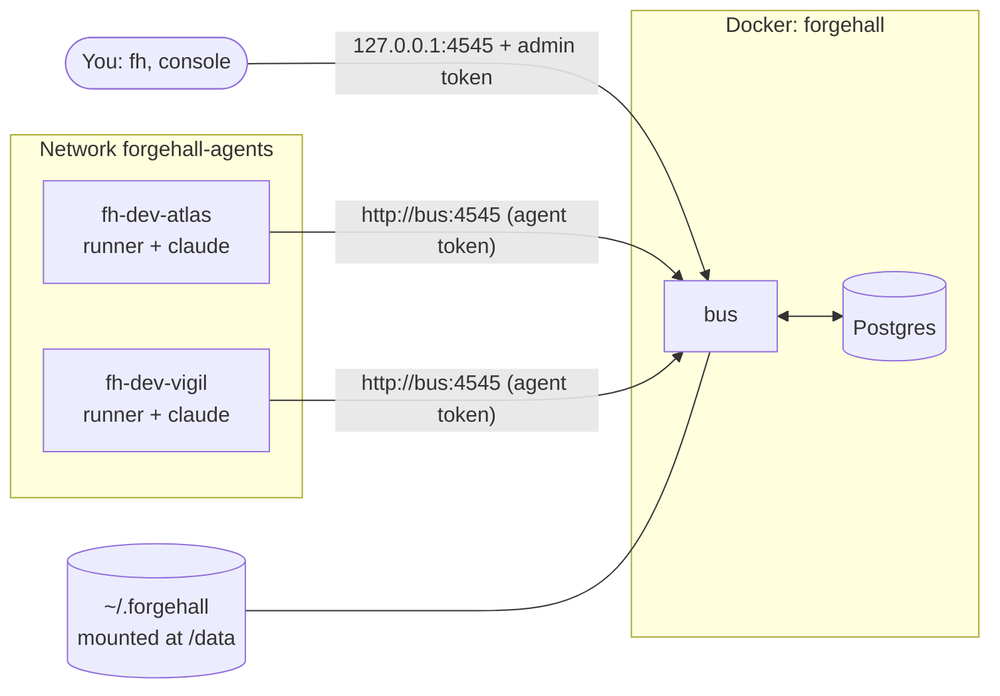
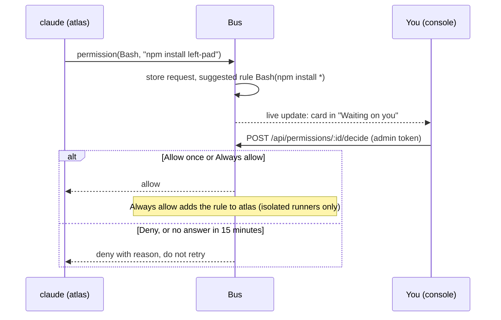

# Isolation and permissions

Agents are model-driven and can be steered by text they read, so Forgehall assumes any agent can do something wrong. Two things limit the damage: **where an agent runs** (isolation) and **what it may do there** (tool permissions). Both are **implemented** for Docker. VM isolation (Incus) is **planned** for phase 5.

## Isolated by default

Every runner reports where it executes when it asks the bus for work (`POST /runner/claim`, body `{"mode": ...}`):

| Mode | Meaning | Status |
|---|---|---|
| `container` | Inside the runner image (it sets `FORGEHALL_RUNNER_MODE=container`) | Implemented |
| `vm` | Inside an Incus VM | Planned (phase 5) |
| `host` | Anything else, such as `node packages/runner/dist/index.js` on your machine | Implemented, off by default |

The bus answers `403` to a `host` runner and the runner exits with an explanation. To allow it, turn on **Settings, "Allow agents directly on this machine"** in the console (`allow_host_runners`). Even then, host runs are stricter, not looser: they get **no standing permissions**, so every tool use is asked to you (see below).

The mode is **self-reported** by the runner. It prevents accidental host runs; it does not stop a determined local user, who could start a runner that claims `container`. The real boundary is that only you control the machine and the admin token.

## The stack

The bus runs in Docker, next to Postgres, so that isolated agents can reach it.

- `fh setup` creates `~/.forgehall` (the admin token with mode `0600`, and `upstreams/`) and writes `infra/docker/.env`.
- The bus mounts `~/.forgehall` at `/data`, publishes **only `127.0.0.1:4545`** on your machine, and joins the `forgehall-agents` network. Agents reach it there as `http://bus:4545`.
- Why the bus is in the stack: with rootless Docker or Docker Desktop, containers cannot reach a service listening on the host. See [ADR 0008](../adr/0008-isolated-agents-and-permission-requests.md).

Start it with the steps in [Getting started](../getting-started.md) and run agents with [Run agents in Docker](../guides/run-agents-in-docker.md).

## The supervisor

Agent containers are started, stopped and restarted by [`fh supervise`](../reference/cli.md#fh-supervise---install--uninstall), a process on your host that runs as your user. It is the only Forgehall component that talks to Docker for agents. The bus stores what you want (start, stop, restart) and the supervisor applies it. The bus does not do this itself, because Docker access is control over the machine and the bus talks to agents all day. A compromised bus can at most ask to start or stop existing agents with the fixed runner image.

## Two kinds of tokens

| Token | Held by | Opens |
|---|---|---|
| **Admin token** (`~/.forgehall/admin-token`) | You: `fh`, and the console's dev server | Everything under `/api`: approvals, settings, permission decisions, creating tasks and repos |
| **Agent token** (`fh agent token`) | One agent | Only `/mcp`, `/runner` and `/git`, scoped to its workspace |

Agents share a network with the bus but never get the admin token, so they cannot approve their own requests: a call to `/api` from the agents network gets `401` (verified). The console dev server adds the admin token server-side when it proxies `/api`; it is never in the browser bundle.

## Tool permissions

Rules use Claude Code's own syntax: `Tool` or `Tool(pattern)`, such as `Bash(npm install *)`. Claude Code applies them itself (`--permission-mode default`). The bus decides which rules a run gets.

Defaults for isolated runners:

| Rule set | Contents |
|---|---|
| **Allow** | File tools (`Read`, `Glob`, `Grep`, `Edit`, `Write`); inspect, test and build commands such as `ls`, `cat`, `grep`, `rg`, `node`, `npm test`, `npm run`, `pnpm test`, `pytest`, `dotnet test`; read-only git (`git status`, `diff`, `log`, `show`) |
| **Ask** | Package installs (`npm install`, `pnpm add`, `pip install`, `dotnet add`); network (`curl`, `wget`, `WebFetch`, `WebSearch`); recursive `rm` |
| **Deny** | `sudo` and `su`; reading secrets (`.env`, `*.pem`, `id_rsa*`, `~/.ssh`, `~/.claude`) |

The exact lists are `ISOLATED_DEFAULTS` in `packages/bus/src/permissions.ts`. An agent can have additions in its config (`permissions`: `allow`, `ask`, `deny`); "Always allow" writes there. On `host` runners the allow list is always empty (standing rules, including remembered ones, do not apply), so **everything not denied is asked**.

### Permission requests

Anything neither allowed nor denied becomes a **permission request**. Claude Code calls the bus's internal `permission` tool (`--permission-prompt-tool mcp__bus__permission`, see [MCP tools](../reference/mcp-tools.md#permission-internal)), and the run waits for your answer.

The console shows a card with **Allow once**, **Always allow** and **Deny** (with an optional reason) in **Waiting on you**, in the thread and on the agent page. Unanswered requests expire after 15 minutes (`PERMISSION_TIMEOUT_MS`) and count as denied. The agent is told the action was denied and must not retry it; if the action is needed it should ask you in the thread.

Example: atlas wants to run `npm install left-pad`. You choose **Always allow**: the rule `Bash(npm install *)` is added to atlas's permissions and later installs run without asking, on isolated runners only. You deny `rm -rf node_modules` instead, with the reason "recreate it with npm ci": the agent sees the denial and the reason, and does not retry. This was validated with a real run: a denied `rm` was respected.

Every request and its answer is stored, so the history is an audit trail.

## Defense in depth

No single layer is trusted alone.

| Layer | What it limits | Status |
|---|---|---|
| **Isolation** | The agent's blast radius is its own container (non-root, its own work volume), not your machine | Docker implemented, VMs planned |
| **Provider credentials and staging remote** | Agents never hold write credentials to your upstream; they push only `fh/*` branches to a staging remote and only the bus publishes, after you approve | Implemented ([ADR 0007](../adr/0007-runner-handles-git-and-staging-remote.md)) |
| **Permission rules** | Which tools run without asking, which are asked and which are refused | Implemented |
| **Approval requests** | Anything not covered by a rule needs your answer; merges need your approval | Implemented |
| **Admin-token-protected API** | Agents on the agents network cannot act as you | Implemented |
| **Audit** | Run events, permission requests and approvals are stored | Implemented |

## What is not covered

- Containers share your machine's kernel. A kernel or Docker escape is out of scope until VMs arrive.
- Secrets passed to a container as environment variables (the agent token, the Claude token) are visible to anyone who can run `docker inspect` on this machine. See [SECURITY.md](../../SECURITY.md).
- Agents reach the network from their container. `curl`, `wget`, `WebFetch` and `WebSearch` are asked by default, but a network allowlist is **planned** (phase 5).
- The runner mode is self-reported, as described above.

See also: [ADR 0008](../adr/0008-isolated-agents-and-permission-requests.md), [Configuration](../reference/configuration.md), [Console API](../reference/console-api.md).
