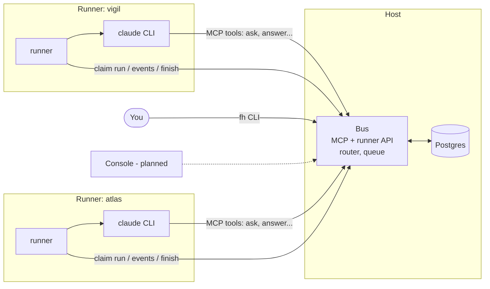

# Overview

Forgehall is a small system around one idea: each agent is the official Claude Code CLI, and Forgehall supplies everything the CLI does not have: a shared message bus, routing, a queue, usage tracking, git staging with approvals and (planned) learning.

Legend: **[now]** is implemented, **[planned]** is not built yet.

## Architecture



## The five pieces

1. **Bus [now]**. The single source of truth. It stores workspaces, agents, threads, messages, runs and run events in Postgres. It exposes MCP tools to agents, a small HTTP API to runners, the console API, and git smart HTTP for the staging remotes of registered repositories. See [MCP tools](../reference/mcp-tools.md), [Runner API](../reference/runner-api.md) and [Console API](../reference/console-api.md).
2. **Dispatcher [now, inside the bus]**. Turns messages into runs, chooses model and effort with the [router](model-routing-and-limits.md), and applies queue priority and concurrency. Today the concurrency cap is per workspace (`MAX_RUNNING`).
3. **Runner [now]**. A daemon, one per agent. It claims a run, executes the engine in a per-thread directory (for repository threads, a checkout of the thread branch; the runner commits and pushes afterwards, agents never run git), forwards the event stream, and reports session id, tokens, cost and usage when the run ends. Phase 1 runs on the host; a Docker image is the remaining phase 1 item.
4. **Claude Code CLI [now]**. The engine. Forgehall does not implement an agent loop. See [ADR 0001](../adr/0001-claude-code-cli-as-engine.md).
5. **Console [now]**. A web UI over the bus for threads, branches and diffs, approvals and activity (`packages/console`). The `fh` CLI covers the same operations except deciding approvals.

Only the bus (with dispatcher), runner and console are code we write. Repository provider adapters for GitHub and Azure DevOps (`packages/providers`) are planned; the `local` provider (any git URL or path) is built into the bus.

## Git in one paragraph

Agents edit files and never run git. The bus hosts a staging remote per repository; the runner pushes each thread's work to a `fh/<thread>` branch there; when you approve, the bus merges the pinned commit and publishes it to the upstream. Details: [Workspaces](workspaces.md#repositories-and-the-staging-remote), [Threads and messages](threads-and-messages.md#repository-threads-and-approvals), [ADR 0007](../adr/0007-runner-handles-git-and-staging-remote.md).

## Why the Claude Code CLI is the engine

- It is the official, unmodified binary, authenticated with your own subscription. That is the reading of the subscription terms Forgehall follows (own account, own use, no token brokering). It is an interpretation, not a guarantee; confirm with Anthropic before relying on it commercially.
- Its agent loop, tools, permission system, skills and memory are maintained by Anthropic.
- A thin `Engine` interface (`run(EngineRun) -> EngineResult`) keeps the door open to other engines without touching the bus.

The trade-off is a fixed prompt overhead on every run (roughly 100k cached tokens in measurements so far, mostly cache reads) and dependency on CLI behaviour. Details and alternatives: [ADR 0001](../adr/0001-claude-code-cli-as-engine.md).

## Event-driven runs with session resume

Agents are not long-lived processes and there is no loop that polls for work. A run exists only because a message arrived:

1. A message addressed to an agent is written to the database and a run is queued for that agent and thread (unless one is already waiting).
2. The agent's runner claims the run. The bus builds a prompt from all messages not yet delivered to that agent in that thread.
3. The runner starts `claude -p <prompt> --model ... --effort ... --resume <session_id>`. The session id is stored per agent and thread, so the agent continues the same conversation context.
4. When the agent calls `ask` or `verify` it ends its turn. The process exits; the reply later arrives as a new run.

This saves usage limits (no idle sessions burning tokens) and lets agents live in different environments. Rationale: [ADR 0003](../adr/0003-event-driven-runs-with-session-resume.md).

## What a run looks like on the wire

```text
runner  POST /runner/claim            -> run + prompt + session id (or 204)
claude  mcp__bus__ask / answer ...    -> messages, new runs for others
runner  POST /runner/runs/:id/events  -> raw stream-json events, batched
runner  POST /runner/runs/:id/finish  -> ok, session id, tokens, cost, rate limits
```

## Next

- [Workspaces](workspaces.md)
- [Threads and messages](threads-and-messages.md)
