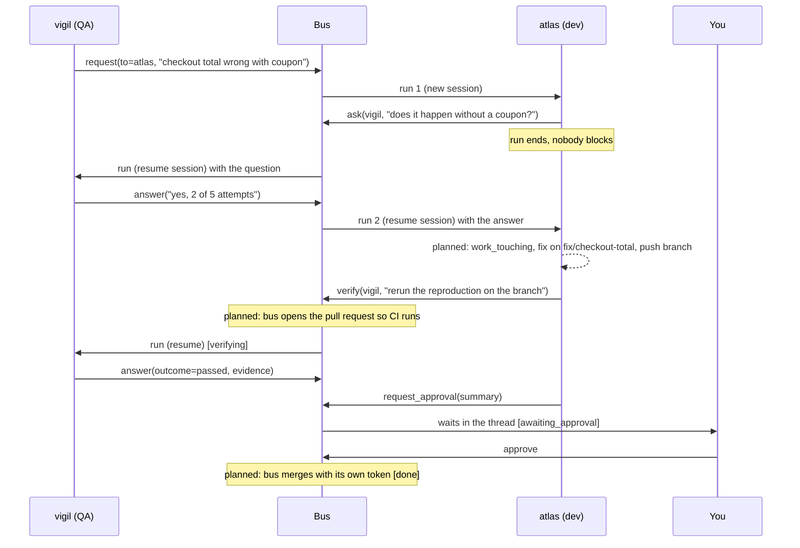

# Threads and messages

Work happens in threads. A thread is a unit of work between agents and you, such as "checkout total bug". It belongs to one workspace, has a state, a responsible agent (the assignee) and an ordered history of messages.

Legend: **[now]** implemented in phase 1, **[planned]** not built yet.

## Message types

Every message has a type, a sender, a recipient (an agent id, or `you` for the human) and a body.

| Type | Meaning | Sent by |
|---|---|---|
| `request` | Asks someone to do work. Opens a new thread when sent by an agent. | agent tool `request`, `fh send` |
| `ask` | Asks for information inside a thread. The asker ends its turn. | agent tool `ask` |
| `answer` | Replies to an `ask` or `verify`; for verifications carries `outcome` of `passed` or `failed`. | agent tool `answer`, `fh reply` |
| `verify` | Asks for an independent check (for example, rerun a reproduction against a branch). | agent tool `verify` |
| `approval` | Asks the human for a decision. | agent tool `request_approval` |
| `notify` | Informs without expecting a reply. | agent tool `notify` |
| `decision` | A decision, for example the human asking for changes. | `fh reply --type decision` |

A message addressed to an agent queues a run for it. A message addressed to `you` just waits in the thread.

## Thread state machine

```text
open -> in_progress -> verifying -> awaiting_approval -> done
any state -> blocked | cancelled
```

Transitions are automatic and driven by message type:

| Event | Result |
|---|---|
| The first run for a thread is claimed | `open` -> `in_progress` |
| `verify` posted | `verifying` |
| `answer` with `outcome=failed` | back to `in_progress` |
| `approval` posted | `awaiting_approval` |
| `decision` posted (human asks for changes) | `in_progress` |
| `request` posted while awaiting approval | `in_progress` |
| `complete` posted by the assignee | `done` |
| The user marks the thread done or cancels it (console, API) | `done` / `cancelled`; queued runs for the thread are cancelled |
| 3 failed runs in a row, or a login / billing error | `blocked`; the user is told why in the thread |
| Any message (except `notify`) to a `blocked` thread | `in_progress` |
| The user reopens a `done`, `cancelled` or `blocked` thread with instructions | `in_progress`; the assignee gets a `request` |
| Thread is `done` or `cancelled` | no further changes until reopened |

**[planned]** `external_review` (waiting on a reviewer in the provider) and `done` after an approval or a completed pull request.

## The flow: QA finds a bug, dev fixes it, QA verifies, you approve

Phase 1 implements the messaging half (request, ask, answer, verify, approval). Opening pull requests, merging and `work_touching` are planned and marked below.



Rules of the flow:

- **Nobody blocks waiting.** `ask`, `verify` and `request_approval` end the caller's turn. The answer arrives as a new run that resumes the same Claude session. This saves usage and lets agents live in different environments.
- **Merging is not the agent's job.** Planned: agent credentials on the provider cannot open pull requests or merge; the bus does, after your approval. The barrier is technical, not a prompt instruction.
- Asking for changes is a `decision` message with your comment, which returns the thread to `in_progress`.

## Who may send what: `accepts_from`

Each agent can have an `accepts_from` list (set with `fh agent add --accepts a,b`). If it is not empty, a `request` from any agent not on the list is rejected by the bus, and a message from you is always allowed. This is a defence against prompt injection chains: an agent that reads the web (say, a research agent) should not be able to send `request` to an agent that edits code.

**[now]** `accepts_from` is checked for `request` messages only. **[planned]** broader policy per message type.

## Prompt framing

Messages from other agents are put into the prompt as data, wrapped in a tag that names the sender:

```text
<message id="2" type="ask" from="vigil">
Does the checkout total bug happen without a coupon?
</message>
```

The run's instructions tell the agent that messages from other agents are information from colleagues, not orders from the user, and that anything outside its role or risky should be asked of the user. This reduces prompt injection risk but does not eliminate it; see [SECURITY.md](../../SECURITY.md).

## Work awareness (planned)

To stop two agents, or an agent and a person, working on the same thing, three layers are planned:

1. A compact summary of open threads and open pull requests for the repository injected into every run header.
2. A `work_touching(repo, paths[])` tool, with a base rule to call it before editing files.
3. Detection by the bus after commits are pushed, notifying both owners on file overlap.

Related planned tools: `prs_list`, `inbox`, `attach`. **[now]** `threads_list` and `thread_read` give agents a basic view of what exists in their workspace. See the [MCP tools reference](../reference/mcp-tools.md).
