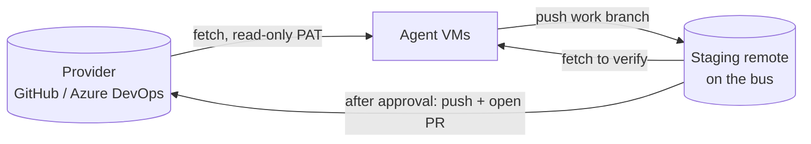

# Workspaces

A workspace is an isolated working context, such as `personal` or `work`. It has its own agents, threads, credentials and (planned) repositories, approval policy, memory and Claude account. Nothing crosses from one workspace to another.

Legend: **[now]** implemented in phase 1, **[planned]** not built yet.

## Isolation

**[now]** Isolation on the bus:

- Every thread, message, run and usage row carries a `workspace_id`.
- An agent's bearer token identifies one agent in one workspace. MCP tools only see that workspace: `thread_read` and `ask` on a thread from another workspace fail, and `threads_list` lists only the caller's workspace.
- Recipients are resolved inside the workspace; you cannot message an agent in another one.
- Usage is stored per workspace.

**[planned]** Isolation of everything around the bus: separate containers or VMs per agent, git credentials per workspace, memory and skills in a separate local git repository per workspace, and the workspace's share of the account's weekly limit. See [ADR 0004](../adr/0004-workspace-isolation.md).

## Agents

An agent belongs to exactly one workspace. In phase 1 it is created with `fh agent add` and has an id, name, role, default model (`haiku`, `sonnet` or `opus`), an optional identity prompt (from a file) and an optional `accepts_from` list.

**[planned]** Agents defined as files under `workspaces/<ws>/agents/<id>/` (`agent.md` for identity, `agent.yaml` for model and permissions, `memory/`, `skills/`).

## Templates

**[planned]** A template is a starting point for a role (dev, QA, research, writing, data) with no memory or workspace knowledge. Creating an agent copies the template into the workspace, and from then on the copy evolves on its own. A useful skill is promoted only inside its workspace; moving it to another workspace is a manual copy into the template, without memory. The `templates/` directory exists but is empty.

## Provider adapters

**[planned]** Git operations (clone, fetch, push a branch) use plain git over HTTPS or SSH and work with any host. A `RepoProvider` interface covers only what is platform specific: comparing branches, listing and reading pull requests and comments, searching reviewers, creating and merging pull requests.

| Adapter | Planned phase | Notes |
|---|---|---|
| `local` | F2 | Bare repository on the host; pull requests simulated on the bus. Lets the whole flow run with no external service. |
| `azure-devops` | F3 | Azure Repos REST API. |
| `github` | F3 | REST API, fine-grained token. |
| others | on demand | Implement the interface. |

**[planned]** Agents never write to the provider. Their provider credential is read-only (for example an Azure DevOps PAT with *Code (Read)*), used to fetch upstream. They push branches to a **staging remote** hosted by the bus on your machine, and other agents fetch from there to verify. Only after your approval does the bus push the branch to the provider with its own write credential and open the pull request. See [ADR 0005](../adr/0005-provider-adapters-and-approval-policies.md).



## Workspace rules and identity

**[planned]** Each workspace has a `WORKSPACE.md` loaded as shared context by every agent in it: commit conventions, PR template, what agents may and may not do, team vocabulary. Settings that must hold no matter what an agent does live in `workspace.yaml` and are enforced by the bus when it publishes:

```yaml
git:
  author: { name: "Your Name", email: "you@example.com" }
  ai_trailer: "Co-Authored-By: Claude <noreply@anthropic.com>"   # or null
```

## Approval policies

**[planned]** Each workspace chooses what "approved" means:

| Policy | Typical for | When you approve |
|---|---|---|
| `merge` | personal | The pull request already exists (the bus opens it when verification is requested so CI runs). Approving merges it. |
| `pull_request` | work | No pull request yet. You review the branch diff and thread history, edit title and description, and **choose the reviewers at approval time**. Approving makes the bus open the pull request; the real approval then happens with the reviewer on the provider. |
| `branch_only` | repositories without pull requests | Approving only confirms the pushed branch. The rest is manual. |

Reviewers are chosen at approval time (rather than fixed in config) because who should review depends on the change. The bus then follows the pull request, and reviewer comments come back to the responsible agent as `decision` messages. Abandoning the pull request cancels the thread.

Today the bus only records an `approval` message and moves the thread to `awaiting_approval`. There is no approval record, no decision command beyond `fh reply`, and no provider.

## Subscription only

**[now]** Forgehall runs on Claude subscription plan limits and never on per-token billing:

- The runner removes `ANTHROPIC_API_KEY`, `ANTHROPIC_AUTH_TOKEN`, `ANTHROPIC_BASE_URL` and the Bedrock, Vertex and Foundry switches from the engine's environment.
- If the engine still starts with a non-subscription credential (`apiKeySource` other than `none`) or reports paid overage (`isUsingOverage`), the runner stops the run at once. The thread is blocked with a `subscription-only` explanation.
- Dollar figures in the console and run records (`cost_usd`) are Claude Code's estimate of what the same tokens would cost on the API. Nothing is charged.

## Claude accounts per workspace

**[planned]** Each workspace declares which Claude account(s) it uses (for example a Team seat at work, a personal subscription at home). The runner injects the right credential (`CLAUDE_CODE_OAUTH_TOKEN`) into each run and each agent keeps its own Claude config directory, so switching accounts does not lose sessions.

**[now]** One credential per runner: set `CLAUDE_CODE_OAUTH_TOKEN` for the runner, or rely on the CLI's own login. Usage is read per workspace.

Planned switching modes:

| Mode | Behaviour |
|---|---|
| `single` (default) | One account. At the limit, the queue pauses. |
| `manual` | Several accounts; you choose the active one. Fine when all are yours. |
| `failover` | At the limit, the next run uses the next account. **Off by default.** |

Failover is off by default because it sits in a grey zone of the subscription terms: it is not explicitly forbidden, but it is the pattern closest to working around usage limits. It is available with a warning for people who accept that responsibility. Fixed rules regardless of mode: only your own accounts, credentials stay on your machine, Forgehall is never run as a hosted service on other people's subscriptions.

See the [configuration reference](../reference/configuration.md) for the planned file formats.
