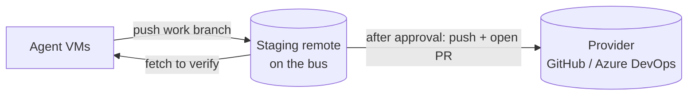

# Workspaces

A workspace is an isolated working context, such as `personal` or `work`. It has its own agents, threads, credentials, repositories, approval policy and (planned) memory and Claude account. Nothing crosses from one workspace to another.

Legend: **[now]** implemented, **[planned]** not built yet.

## Isolation

**[now]** Isolation on the bus:

- Every thread, message, run and usage row carries a `workspace_id`.
- An agent's bearer token identifies one agent in one workspace. MCP tools only see that workspace: `thread_read` and `ask` on a thread from another workspace fail, and `threads_list` lists only the caller's workspace.
- Recipients are resolved inside the workspace; you cannot message an agent in another one.
- Usage is stored per workspace.

**[now]** Each agent runs in its own container (`fh agent run`), see [Isolation and permissions](isolation-and-permissions.md).

**[planned]** Isolation of everything around the bus: VMs per agent, git credentials per workspace, memory and skills in a separate local git repository per workspace, and the workspace's share of the account's weekly limit. See [ADR 0004](../adr/0004-workspace-isolation.md).

## Agents

An agent belongs to exactly one workspace. It has an id, name, role, default model (`haiku`, `sonnet` or `opus`), an optional identity prompt and an optional `accepts_from` list.

**[now]** Create workspaces and agents with `fh workspace add` and `fh agent add`, or in the console: workspace switcher → **New workspace**; the **+** next to AGENTS in the sidebar → **Add agent**; on an agent's page, **Settings** edits name, role, model, who can send it tasks and identity. Creating an agent does not start it: run `fh agent run <ws> <id>` on the host.

### Host access per agent

**[now]** An agent can have its own token for a host (`github`, `azure-devops`), set with the API ([console API](../reference/console-api.md#workspaces-and-agents)) or in the agent's Settings. By default an agent has none. When the agent runs, the runner gives the engine the token as environment variables: `GH_TOKEN` and `GITHUB_TOKEN` for GitHub, `AZURE_DEVOPS_EXT_PAT` for Azure DevOps.

- The token's scopes are the limit, so prefer a read-only one.
- Commands that use it still go through permission requests unless you always allow them.
- It is separate from the workspace publishing credential, which only the bus uses to push and open pull requests and which agents never receive.

See [ADR 0009](../adr/0009-host-access-per-agent.md) and the [configuration reference](../reference/configuration.md).

**[planned]** Agents defined as files under `workspaces/<ws>/agents/<id>/` (`agent.md` for identity, `agent.yaml` for model and permissions, `memory/`, `skills/`).

## Templates

**[planned]** A template is a starting point for a role (dev, QA, research, writing, data) with no memory or workspace knowledge. Creating an agent copies the template into the workspace, and from then on the copy evolves on its own. A useful skill is promoted only inside its workspace; moving it to another workspace is a manual copy into the template, without memory. The `templates/` directory exists but is empty.

## Provider adapters

Git operations (clone, fetch, push a branch) use plain git and work with any host. A `RepoProvider` interface is planned to cover only what is platform specific: comparing branches, listing and reading pull requests and comments, searching reviewers, creating and merging pull requests.

| Adapter | Status | Notes |
|---|---|---|
| `local` | **[now]** | The upstream is any git URL or path that `git push` accepts (for example a bare repository on disk). Approving merges and pushes to it. Register with `fh repo add`. |
| `azure-devops` | **[planned]** F3 | Azure Repos REST API. |
| `github` | **[planned]** F3 | REST API, fine-grained token. |
| others | on demand | Implement the interface. |

### Repositories and the staging remote

**[now]** A workspace registers repositories with `fh repo add <ws> <id> <upstream>`. Each gets a **staging remote**: a bare repository the bus hosts at `$FORGEHALL_HOME/staging/<ws>/<id>.git` and serves over git smart HTTP at `/git/<ws>/<id>.git`. Agents authenticate with their token and reach only their own workspace's repos.

Agents never write to the upstream, and they never run git. The runner checks out a thread's branch from the staging remote before a run and, after a successful one, commits the agent's file changes and pushes them to `fh/<THREAD-ID>`. A `pre-receive` hook accepts only `fh/*` branches and no deletions. Only the bus publishes to the upstream, after your approval. See [ADR 0007](../adr/0007-runner-handles-git-and-staging-remote.md), [ADR 0005](../adr/0005-provider-adapters-and-approval-policies.md) and the how-to [Work on a repository](../guides/work-on-a-repository.md).

Agents' host access is now per agent (see [Host access per agent](#host-access-per-agent)). Agents still do not fetch code from real providers directly: they use the staging remote, so they do not need provider access for code.

**[planned]** Other agents fetching a branch from the staging remote to verify it.

## Workspace rules and identity

**[now]** Commit identity and AI attribution are workspace settings (console **Settings → Publishing**), applied by the bus when it publishes, because the rules differ between a personal project and an employer:

- **Commit identity**: author and committer of published commits, for example `Dana Reyes <dana@example.com>`. Empty: `Forgehall <forgehall@localhost>`.
- **AI trailer** (default on): adds `Co-Authored-By: Claude <noreply@anthropic.com>` to published commits. Turn it off where the employer's policy asks for it.

Agents commit to the thread branch under their own names (`atlas (forgehall)`); that history stays in the staging remote. What reaches the upstream is one squashed commit per approval, with the workspace identity.

**[planned]** A `WORKSPACE.md` loaded as shared context by every agent in the workspace: commit conventions, PR template, what agents may and may not do, team vocabulary.

## Approval policies

Each workspace chooses what "approved" means, in **Settings → Publishing** (default `merge`). In every policy, approving squashes the pinned commit onto the current base branch into one commit (title, the approval summary, the AI trailer if on). Conflicts and a branch that moved since the request are refused and go back to the agent.

| Policy | Typical for | When you approve |
|---|---|---|
| `merge` | personal | The commit becomes the base branch upstream. The thread closes. |
| `pull_request` | work | You set the title and **choose the reviewers**. The bus pushes the branch `fh/<THREAD-ID>`, opens the pull request on GitHub or Azure DevOps and the thread waits in `external_review`. The real approval is the reviewer's on the host: when the bus sees the pull request merged, the thread closes; closed without merging, the thread is `blocked` and you decide. |
| `branch_only` | repositories without pull requests | The bus pushes the branch `fh/<THREAD-ID>`. The thread closes; the rest is manual. |

Reviewers are chosen at approval time (rather than fixed in config) because who should review depends on the change.

**[now]** `merge` and `branch_only` with any repository; `pull_request` with GitHub and Azure DevOps repositories, using the workspace's write credential (**Settings → Publishing → Host credentials**: GitHub fine-grained token with *Contents* and *Pull requests* read/write; Azure DevOps PAT with *Code (Read & Write)* and *Identity (Read)*). Only the bus holds that credential; agents never get it. The host clients are tested against recorded API behaviour; a full run against a real GitHub or Azure DevOps project is still to be done.

**[planned]** Reviewer comments sent back to the responsible agent as `decision` messages; opening the pull request earlier (when verification starts) so CI runs before you approve; a read-only credential for agents to fetch from real providers.

## Billing

**[now]** Forgehall uses whatever authentication you give Claude Code. If you only log in with a subscription (Pro, Max, Team) and set no API key, runs consume your plan limits and nothing else.

Watch out for one thing: an `ANTHROPIC_API_KEY` (or `ANTHROPIC_AUTH_TOKEN`, or the Bedrock, Vertex and Foundry switches) in the runner's environment takes precedence over the subscription login, and those runs are billed per token.

To make that impossible on your machine, run the runner with `FORGEHALL_BILLING=subscription-only` (`fh agent run` passes it to the container when it is set in your shell):

- The runner removes those variables from the engine's environment.
- If the engine still starts with a non-subscription credential (`apiKeySource` other than `none`) or reports paid overage (`isUsingOverage`), the run stops at once and the thread is blocked with a `subscription-only` explanation.

Dollar figures in the console and run records (`cost_usd`) are Claude Code's estimate at API prices. With a subscription login they are not charged.

## Claude accounts per workspace

**[planned]** Each workspace declares which Claude account(s) it uses (for example a Team seat at work, a personal subscription at home). The runner injects the right credential (`CLAUDE_CODE_OAUTH_TOKEN`) into each run and each agent keeps its own Claude config directory, so switching accounts does not lose sessions.

**[now]** One credential per runner: `fh agent run` passes the token from `claude setup-token` (`~/.config/forgehall/claude-token` or `CLAUDE_CODE_OAUTH_TOKEN`) to the container. Only the opt-in host runner can rely on the CLI's own login. Usage is read per workspace.

Planned switching modes:

| Mode | Behaviour |
|---|---|
| `single` (default) | One account. At the limit, the queue pauses. |
| `manual` | Several accounts; you choose the active one. Fine when all are yours. |

There is no automatic switch to another account when one reaches its limit. Anthropic's Usage Policy forbids using multiple accounts to get around restrictions, and an automatic failover exists only to do that. When the active account reaches its limit, the queue pauses until the limit resets. Fixed rules regardless of mode: only your own accounts, credentials stay on your machine, Forgehall is never run as a hosted service on other people's subscriptions. Pay-per-use accounts (API key, Bedrock, Vertex, Foundry) with a daily budget are also planned, for people who want them.

See the [configuration reference](../reference/configuration.md) for the planned file formats.
