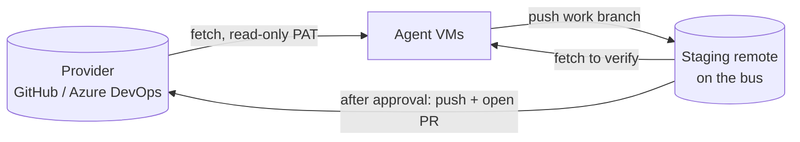

# Workspaces

A workspace is an isolated working context, such as `personal` or `work`. It has its own agents, threads, credentials, repositories, approval policy and (planned) memory and Claude account. Nothing crosses from one workspace to another.

Legend: **[now]** implemented, **[planned]** not built yet.

## Isolation

**[now]** Isolation on the bus:

- Every thread, message, run and usage row carries a `workspace_id`.
- An agent's bearer token identifies one agent in one workspace. MCP tools only see that workspace: `thread_read` and `ask` on a thread from another workspace fail, and `threads_list` lists only the caller's workspace.
- Recipients are resolved inside the workspace; you cannot message an agent in another one.
- Usage is stored per workspace.

**[planned]** Isolation of everything around the bus: separate containers or VMs per agent, git credentials per workspace, memory and skills in a separate local git repository per workspace, and the workspace's share of the account's weekly limit. See [ADR 0004](../adr/0004-workspace-isolation.md).

## Agents

An agent belongs to exactly one workspace. In phase 1 it is created with `fh agent add` and has an id, name, role, default model (`haiku`, `sonnet` or `opus`), an optional identity prompt (from a file) and an optional `accepts_from` list.

**[planned]** Agents defined as files under `workspaces/<ws>/agents/<id>/` (`agent.md` for identity, `agent.yaml` for model and permissions, `memory/`, `skills/`).

## Templates

**[planned]** A template is a starting point for a role (dev, QA, research, writing, data) with no memory or workspace knowledge. Creating an agent copies the template into the workspace, and from then on the copy evolves on its own. A useful skill is promoted only inside its workspace; moving it to another workspace is a manual copy into the template, without memory. The `templates/` directory exists but is empty.

## Provider adapters

Git operations (clone, fetch, push a branch) use plain git and work with any host. A `RepoProvider` interface is planned to cover only what is platform specific: comparing branches, listing and reading pull requests and comments, searching reviewers, creating and merging pull requests.

| Adapter | Status | Notes |
|---|---|---|
| `local` | **[now]** | The upstream is any git URL or path that `git push` accepts (for example a bare repository on disk). Approving merges and pushes to it. Register with `fh repo add`. |
| `azure-devops` | **[planned]** F3 | Azure Repos REST API. |
| `github` | **[planned]** F3 | REST API, fine-grained token. |
| others | on demand | Implement the interface. |

### Repositories and the staging remote

**[now]** A workspace registers repositories with `fh repo add <ws> <id> <upstream>`. Each gets a **staging remote**: a bare repository the bus hosts at `$FORGEHALL_HOME/staging/<ws>/<id>.git` and serves over git smart HTTP at `/git/<ws>/<id>.git`. Agents authenticate with their token and reach only their own workspace's repos.

Agents never write to the upstream, and they never run git. The runner checks out a thread's branch from the staging remote before a run and, after a successful one, commits the agent's file changes and pushes them to `fh/<THREAD-ID>`. A `pre-receive` hook accepts only `fh/*` branches and no deletions. Only the bus publishes to the upstream, after your approval. See [ADR 0007](../adr/0007-runner-handles-git-and-staging-remote.md), [ADR 0005](../adr/0005-provider-adapters-and-approval-policies.md) and the how-to [Work on a repository](../guides/work-on-a-repository.md).

**[planned]** A read-only provider credential for agents (for example an Azure DevOps PAT with *Code (Read)*) to fetch from real providers, and other agents fetching a branch from the staging remote to verify it.



## Workspace rules and identity

**[planned]** Each workspace has a `WORKSPACE.md` loaded as shared context by every agent in it: commit conventions, PR template, what agents may and may not do, team vocabulary. Settings that must hold no matter what an agent does live in `workspace.yaml` and are enforced by the bus when it publishes:

```yaml
git:
  author: { name: "Your Name", email: "you@example.com" }
  ai_trailer: "Co-Authored-By: Claude <noreply@anthropic.com>"   # or null
```

## Approval policies

Each workspace chooses what "approved" means, in the `approval_policy` setting (default `merge`). Only `merge` is implemented.

| Policy | Status | Typical for | When you approve |
|---|---|---|---|
| `merge` | **[now]** | personal | You review the branch diff. Approving merges the pinned commit into the base branch (no working tree, conflicts are refused) and pushes it to the upstream. With real providers, the pull request is meant to exist earlier so CI runs (planned). |
| `pull_request` | **[planned]** | work | No pull request yet. You review the branch diff and thread history, edit title and description, and **choose the reviewers at approval time**. Approving makes the bus open the pull request; the real approval then happens with the reviewer on the provider. |
| `branch_only` | **[planned]** | repositories without pull requests | Approving only confirms the pushed branch. The rest is manual. |

Reviewers are chosen at approval time (rather than fixed in config) because who should review depends on the change. The bus then follows the pull request, and reviewer comments come back to the responsible agent as `decision` messages. Abandoning the pull request cancels the thread.

**[now]** `request_approval` on a repository thread creates an approval record pinned to the branch head commit. You approve or request changes in the console or with `POST /api/approvals/:id/decide`; there is no `fh` command for it yet. See [Threads and messages](threads-and-messages.md#repository-threads-and-approvals). The `pull_request` and `branch_only` policies return an error if selected.

## Billing

**[now]** Forgehall uses whatever authentication you give Claude Code. If you only log in with a subscription (Pro, Max, Team) and set no API key, runs consume your plan limits and nothing else.

Watch out for one thing: an `ANTHROPIC_API_KEY` (or `ANTHROPIC_AUTH_TOKEN`, or the Bedrock, Vertex and Foundry switches) in the runner's environment takes precedence over the subscription login, and those runs are billed per token.

To make that impossible on your machine, run the runner with `FORGEHALL_BILLING=subscription-only`:

- The runner removes those variables from the engine's environment.
- If the engine still starts with a non-subscription credential (`apiKeySource` other than `none`) or reports paid overage (`isUsingOverage`), the run stops at once and the thread is blocked with a `subscription-only` explanation.

Dollar figures in the console and run records (`cost_usd`) are Claude Code's estimate at API prices. With a subscription login they are not charged.

## Claude accounts per workspace

**[planned]** Each workspace declares which Claude account(s) it uses (for example a Team seat at work, a personal subscription at home). The runner injects the right credential (`CLAUDE_CODE_OAUTH_TOKEN`) into each run and each agent keeps its own Claude config directory, so switching accounts does not lose sessions.

**[now]** One credential per runner: set `CLAUDE_CODE_OAUTH_TOKEN` for the runner, or rely on the CLI's own login. Usage is read per workspace.

Planned switching modes:

| Mode | Behaviour |
|---|---|
| `single` (default) | One account. At the limit, the queue pauses. |
| `manual` | Several accounts; you choose the active one. Fine when all are yours. |

There is no automatic switch to another account when one reaches its limit. Anthropic's Usage Policy forbids using multiple accounts to get around restrictions, and an automatic failover exists only to do that. When the active account reaches its limit, the queue pauses until the limit resets. Fixed rules regardless of mode: only your own accounts, credentials stay on your machine, Forgehall is never run as a hosted service on other people's subscriptions. Pay-per-use accounts (API key, Bedrock, Vertex, Foundry) with a daily budget are also planned, for people who want them.

See the [configuration reference](../reference/configuration.md) for the planned file formats.
