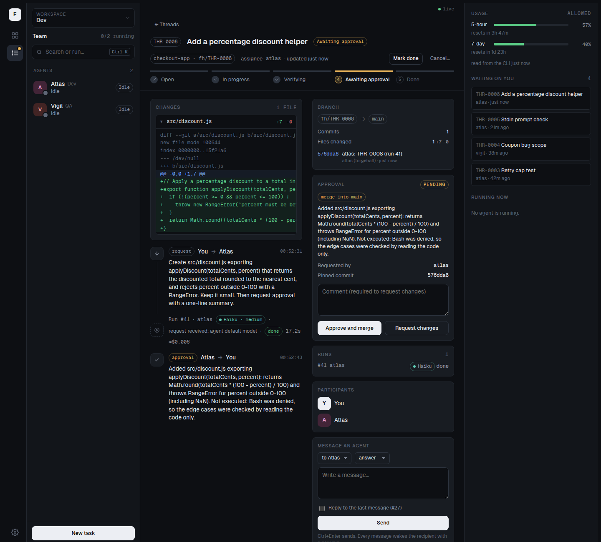

# Work on a repository

You will register a sample git repository with a bug, ask an agent to fix it on its own branch, review the diff in the console, approve it, and see the fix land in the repository.

Status: **implemented (phase 2)** for the `local` provider with the `merge` approval policy, and for GitHub and Azure DevOps with `merge` when the workspace has a host credential (see [On GitHub or Azure DevOps](#on-github-or-azure-devops)). Reviewer comments sent back to the agent are planned.

Prerequisites: the setup from [Getting started](../getting-started.md) (stack running, `atlas` started with `fh agent run dev atlas`, console) and `git` installed. Agents use file tools and the allowed test and build commands; they do not run git.

## 1. Create a sample upstream

A bare repository stands in for your real remote. The bus runs in a container and sees only `~/.forgehall`, so a local upstream must live under `~/.forgehall/upstreams`. A git URL works too.

```bash
mkdir -p ~/.forgehall/upstreams && cd ~/.forgehall/upstreams
git init -q --bare -b main checkout-app.git
git clone -q checkout-app.git seed && cd seed
cat > total.js <<'JS'
// Returns the order total in cents after a percentage coupon.
export function total(items, couponPercent = 0) {
  const sum = items.reduce((acc, i) => acc + i.cents, 0);
  return Math.floor(sum - sum * couponPercent / 100); // bug: rounds down
}
JS
git add -A && git commit -qm "Add total()" && git push -q origin HEAD:main
```

## 2. Register the repository

From the Forgehall checkout:

```bash
fh repo add dev checkout-app ~/.forgehall/upstreams/checkout-app.git --base main
# repo dev/checkout-app ok · upstream /data/upstreams/checkout-app.git · base main · staging ready
fh repos dev
# checkout-app  local  main  /data/upstreams/checkout-app.git
```

The upstream is stored as the path the bus sees (`/data/upstreams/...`). `fh repo add` goes through the bus API, because the bus owns the staging remotes. It translates the host path to the bus's `/data` mount, and refuses a local path outside `~/.forgehall` with an explanation (use a git URL instead). The staging remote is created at `~/.forgehall/staging/dev/checkout-app.git` on your machine (`/data/staging/...` in the bus container). Agents push there, never to your upstream.

For a repository on GitHub or Azure DevOps you can also use the console: **Settings → Repositories → Add repository**, or **+ Add** next to the repository field in **New task**. Paste the URL (`https://github.com/acme/checkout-app`, `https://dev.azure.com/acme/Shop/_git/checkout-app` or the short `https://dev.azure.com/acme/_git/checkout-app`); the host is detected from it. For a private repository, add the workspace's token in **Settings → Publishing** first. Local paths still need `fh repo add`.

## 3. Ask atlas to fix the bug

With the CLI:

```bash
fh send dev atlas "total() in total.js rounds down; it should round to the nearest cent. Fix it, then ask for approval." \
  --title "Coupon rounding" --repo checkout-app
# THR-0001 opened for atlas
```

Or in the console: **New task**, pick `atlas`, choose the repository `checkout-app` in the **Repository** field, and send.

The thread gets its own branch, `fh/THR-0001`. When atlas starts, the runner checks that branch out in `/home/agent/work/THR-0001/` inside atlas's container and atlas edits files there with its file tools. When the run ends successfully, the runner commits the change and pushes it to the staging remote; you will see a `git.push` event in the run's activity.

## 4. Watch the branch and the diff

Open the thread in the console. The **branch card** shows `fh/THR-0001` against `main`, with commits and changed files, and the **diff viewer** shows the patch. The same data is available as JSON:

```bash
curl -s -H "Authorization: Bearer $(cat ~/.forgehall/admin-token)" \
  http://127.0.0.1:4545/api/threads/THR-0001/diff | head -c 600
```

You can also inspect the branch in git: `git -C ~/.forgehall/staging/dev/checkout-app.git log main..fh/THR-0001 --stat`.

## 5. Approve and merge



When atlas calls `request_approval`, the thread moves to `awaiting_approval` and an **approval card** appears, pinned to the exact commit atlas pushed. Review the diff, then choose:

- **Approve and merge**: on a local repository, the bus merges that commit into `main` and pushes it to your upstream. The thread closes with the message `Approved and merged into main as <sha>`. On GitHub or Azure DevOps the bus merges the pull request instead; see below.
- **Request changes**: write what should change (required). It goes to atlas as `Changes requested: ...` and starts a new run on the same branch.

## 6. Check the upstream

```bash
git -C ~/.forgehall/upstreams/checkout-app.git log --oneline --graph main
# *   3f9c2ab Merge fh/THR-0001: Coupon rounding
# |\
# | * 81d04e7 atlas: THR-0001 (run 1)
# |/
# * 5a7e1c0 Add total()
```

The merge commit is authored by `Forgehall <forgehall@localhost>`; atlas's commit keeps its own author.

## On GitHub or Azure DevOps

With a repository on GitHub or Azure DevOps and a host token for it in **Settings → Publishing**, `merge` uses a real pull request instead of pushing to the base branch. Token scopes are in the [console API reference](../reference/console-api.md#publishing).

1. **Approval requested.** The bus squashes the pinned commit as usual, pushes it to `fh/THR-0001` on the host and opens a pull request: title = thread title, description = the approval summary and `Thread THR-0001. Opened by Forgehall: approve it in the console to merge.`, with no reviewers. A notice in the thread links to it. If a pull request is already open for the thread (after a request for changes), the bus updates it with the new commit, title and description instead of opening another.
2. **Changes requested.** The pull request stays open while you ask for more changes. Comments on it are not sent to the agent yet (planned).
3. **Approve and merge.** The bus merges the pull request on the host only if its branch is still at the approved commit. The commit is kept as it is (rebase; on GitHub, squashed if rebase merging is disabled in the repository), Azure DevOps completion is waited for, and the source branch is deleted. Conflicts, branch policies (required reviewers, builds) or a moved branch are refused with an explanation. The thread closes with `Approved and merged pull request N (url) into main as <sha>`.
4. **Merged or closed on the host.** If someone merges the pull request on the host, the bus notices within `PR_POLL_SECONDS` and closes the thread. If it is closed (GitHub) or abandoned (Azure DevOps) without merging, pending approvals are withdrawn and the thread is `blocked` with a notice.
5. **Cancel.** Cancelling the thread in the console closes (GitHub) or abandons (Azure DevOps) its open pull request.

Local repositories, and workspaces without a token for the host, keep the behaviour above for `local`: the squashed commit is pushed directly to the base branch.

## What if

**The approval says the branch changed.** Someone (usually the agent, in a later run) pushed after the approval was requested. Approvals are pinned to a commit, and the bus refuses to merge anything you have not seen. Nothing was published. Ask the agent to request approval again; this supersedes the old approval with a new one pinned to the current head.

**The approval says the branch conflicts with `main`.** Another change reached `main` first and touches the same lines. The bus never resolves conflicts. Use **Request changes** with "main moved; update your change on top of it", or reply to the thread; the next run starts from the thread branch, so atlas has to redo the edit against the latest base. Note that the runner starts from the existing thread branch, not from a new `main`, so be explicit about what to redo.

**"Nothing to approve".** `request_approval` on a repo thread fails when the branch has no commits ahead of the base. Atlas must make a change first. If atlas asked for approval during its own run and the run pushed nothing, the approval is withdrawn automatically, the thread goes back to `in_progress` and you get a notice.

**"The agent is still pushing its changes".** Atlas requested approval during its run and the push has not finished. Try again in a moment; the commit is pinned when the run ends.

**Run failed on checkout or push.** The run shows `checkout of fh/THR-0001 failed` or `pushing fh/THR-0001 failed`, and the usual retry rules apply. Check the agent's logs (`docker logs fh-dev-atlas`). `fh agent token` invalidates the token a running container holds; run `fh agent run dev atlas` to restart it with a fresh one.

**Atlas pauses on a tool.** If atlas wants a command that no rule covers (an `npm install`, say), the run waits for you: answer the card in **Waiting on you**. Without an answer it is denied after 15 minutes.

**A message to a busy thread does nothing yet.** Only one run per thread runs at a time; the next one starts when the current one ends.

See also: [CLI reference](../reference/cli.md), [console API](../reference/console-api.md), [ADR 0007](../adr/0007-runner-handles-git-and-staging-remote.md).
